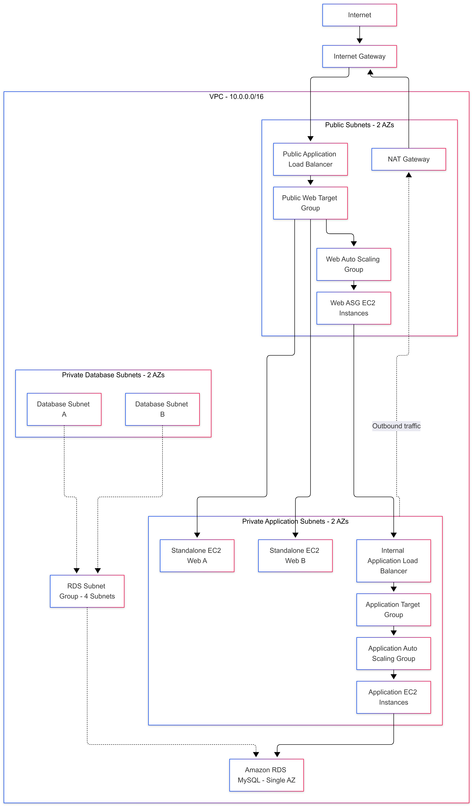

# Three-Tier AWS Terraform DevSecOps Project

Terraform configuration for a three-tier AWS demonstration in `ap-southeast-1`. The current source describes public ingress through an Application Load Balancer (ALB), a web Auto Scaling Group (ASG), an internal ALB, an application ASG, and a private MySQL RDS instance. It also retains two legacy EC2 instances and their public-ALB target registrations during migration.

> This repository describes infrastructure with material cost and data-loss implications. Review the plan and deletion protections before applying or destroying anything. No infrastructure was changed while preparing these documents.

## Architecture



See [architecture.mmd](architecture.mmd) for the editable Mermaid source.
## Configuration

Defaults are declared in `variables.tf` and the AWS provider configuration is in `provider.tf`.

| Variable | Default / requirement |
| --- | --- |
| `project_name` | `terraform-multitier` |
| `environment` | `dev` |
| `aws_region` | `ap-southeast-1` |
| `vpc_cidr` | `10.0.0.0/16` |
| `availability_zones` | `ap-southeast-1a`, `ap-southeast-1b` |
| `instance_type` | `t3.micro` |
| `db_instance_class` | `db.t3.micro` |
| `db_password` | Required, sensitive Terraform variable; at least 8 characters |

Supply the database password through a secure mechanism such as `TF_VAR_db_password` in the current shell or a secrets manager integration. Do not commit it, place it in command history, or publish Terraform state: Terraform state can contain sensitive values even when variables are marked sensitive.

## Deploy and validate

Use an AWS identity with only the permissions needed to manage these resources. These steps are instructions for a future operator; they were not run as part of documentation work.

```powershell
terraform init
terraform fmt -check
terraform validate
terraform plan -out=tfplan
terraform show tfplan
```

Review every proposed create, update, replacement, and destroy. Confirm the target AWS account and region independently. Apply only an approved, reviewed plan:

```powershell
terraform apply tfplan
```

After deployment, inspect the Terraform outputs with `terraform output` and test the public URL from an authorized client. Confirm ALB target health, ASG instance health, SSM managed-node connectivity, and (if required) database reachability from an approved application host. The current app page is a static health demonstration; an HTTP response does not demonstrate database integration or production readiness.

## Security assessment and validation status

The project was scanned using Checkov v3.4.5.

Latest recorded result on 16 November 2026:

- 127 passed
- 30 failed
- 0 skipped

Remaining security findings are documented in [SECURITY-ASSESSMENT.md](SECURITY-ASSESSMENT.md).

Latest Terraform verification:

- terraform fmt -check: passed.
- terraform validate: successful.
- terraform plan: no changes.

A clean Terraform plan does not independently prove runtime health or production security.
## Cost and operational risks

Expect ongoing charges for two ALBs, a NAT Gateway and its data processing, public IPv4/EIP usage, EC2 instances, EBS volumes, and RDS storage/compute/backups. Charges vary by region, traffic, and runtime. The desired capacity is one instance per ASG, with each allowed to grow to two; capacity changes can raise costs. No price estimate is included because the active account pricing, usage, and runtime budget have not been verified.

Important operational characteristics:

- The public ALB and both ALBs have deletion protection enabled; RDS also has deletion protection and requires a final snapshot on deletion. These safeguards can prevent ordinary destroy completion until intentionally changed.
- RDS is single-AZ, so this is not a highly available database deployment. Backups are configured for seven days; storage is capped at 20 GiB by the configured maximum.
- Listeners use plain HTTP, including the public entry point. No TLS certificate, HTTPS listener, WAF, or ALB access logging is defined in the reviewed Terraform source.
- Web and application instances allow outbound HTTPS to `0.0.0.0/0`; application subnets depend on one NAT Gateway, creating a shared egress dependency and AZ failure/cross-AZ traffic considerations.
- The RDS subnet group includes application subnets as well as DB subnets. RDS ingress is restricted to the legacy EC2 and application security groups, but the placement is broader than a database-only subnet group.
- Legacy EC2 resources have `ignore_changes = all`, preserving drift and limiting Terraform's ability to reconcile those instances. Their target attachments remain on the public ALB.
- The RDS password is passed as a Terraform variable. The lifecycle ignores password changes, so changing the input alone may not rotate the live database credential.
- Bootstrap scripts install nginx at instance launch. Package availability, updates, and application behavior depend on external repositories and are not covered by source validation.

## Cleanup

Cleanup can delete workloads and may incur final snapshot/storage charges. First review the current plan and confirm backups and retention requirements. Deletion protection is enabled on the ALBs and RDS; do not remove it casually. After an authorized operator has intentionally disabled protections through a reviewed change, inspect a fresh destroy plan before running:

```powershell
terraform plan -destroy
terraform destroy
```

Retain required RDS final snapshots and any state/backup records according to the data-retention policy. Never publish state or saved plans.

## Outputs

`outputs.tf` exposes VPC ID, public and internal ALB DNS names, application URL, ASG names, RDS endpoint, subnet IDs, and legacy instance private IPs. Outputs may reveal infrastructure details; share only with authorized operators.
